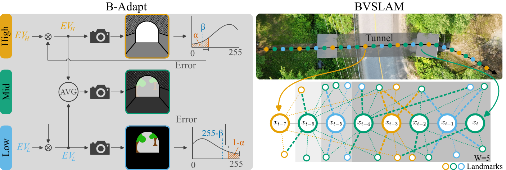
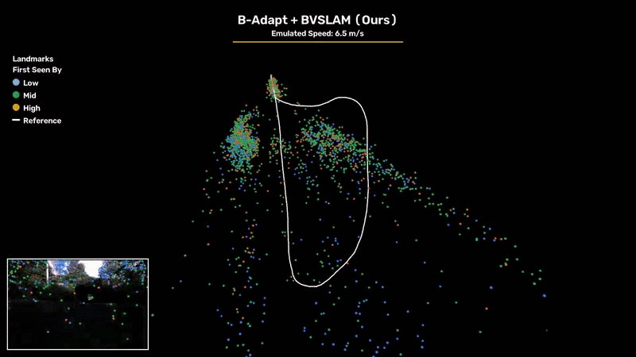

<div align="center">

# Bracketing Shows the Way
### Adaptive Multi-Exposure Policy as Input for Robust Visual SLAM

[Olivier Gamache](https://norlab.ulaval.ca), Anthony Lavertu, David-Alexandre Duclos, Jean-Michel Fortin, François Pomerleau, Philippe Giguère

Northern Robotics Laboratory, Université Laval

[](https://arxiv.org/abs/XXXX.XXXXX)
[](https://norlab-ulaval.github.io/bracketing-shows-the-way/)
[](https://youtu.be/6PZw8dDni28)
[](LICENSE)



</div>

Rapid illumination transitions, such as a tunnel exit, saturate images before auto-exposure (AE) can adapt, and the features a visual SLAM system needs disappear. We mitigate this at two levels:

- **B-Adapt** (acquisition side) is an online bracketing policy for a stereo camera pair. Two independent loops regulate the darkest and brightest exposures from one-sided intensity-tail objectives, and an intermediate exposure bridges them.
- **BVSLAM** (estimation side) is a factor-graph stereo VSLAM that uses the bracketed sequence **directly**, with no HDR merge. It associates SuperPoint/LightGlue features across neighbouring exposure levels.

In a repeated tunnel-exit transition at an emulated 32 m/s, B-Adapt + BVSLAM reduces the RPE by **78 %** compared with AE images.

<div align="center">

<br><sub>B-Adapt + BVSLAM on a loop through two tunnel exits (2× speed). Landmarks are colored by the bracket (Low, Mid, High) that first observed them.</sub>
</div>

---

## Contents

- [Repository layout](#repository-layout)
- [Installation](#installation)
- [Quick start: BVSLAM on the sample data](#quick-start-bvslam-on-the-sample-data)
- [Single-exposure example: FoMo](#single-exposure-example-fomo)
- [Running BVSLAM on your own images](#running-bvslam-on-your-own-images)
- [Acquisition with B-Adapt (ROS 2 driver)](#acquisition-with-b-adapt-ros-2-driver)
- [Parameters](#parameters)
- [License and acknowledgments](#license-and-acknowledgments)
- [Citation](#citation)

## Repository layout

```
driver/        C++17 B-Adapt acquisition library for Basler cameras (stereo pair or single camera, Pylon 12)
driver_ros/    ROS 2 Jazzy node running B-Adapt
bvslam/        BVSLAM: Python factor-graph stereo VSLAM (GTSAM, SuperPoint + LightGlue)
docker/        Dockerfiles for BVSLAM (GPU or CPU) and for the ROS 2 driver
scripts/       Data download and demo
docs/          Project page (GitHub Pages)
```

## Installation

```bash
git clone https://github.com/norlab-ulaval/bracketing-shows-the-way.git
cd bracketing-shows-the-way
```

BVSLAM is pure Python and runs on Linux, with or without a GPU. Install it with Docker or natively. The B-Adapt driver has its own requirements (Pylon SDK, ROS 2) and is only needed to acquire new data; see [Acquisition with B-Adapt](#acquisition-with-b-adapt-ros-2-driver).

**Docker (recommended).** Requirements: Docker. For GPU acceleration you also need an NVIDIA GPU with the [NVIDIA Container Toolkit](https://docs.nvidia.com/datacenter/cloud-native/container-toolkit/latest/install-guide.html).

```bash
docker compose build bvslam        # or bvslam-cpu without a GPU
```

The first build takes a while (about 5–20 min, mostly downloading PyTorch with its CUDA libraries), and the image is about 6 GB. Later builds reuse the cached dependencies and take under a minute.

**Native.** Requirements: Python 3.11 and [uv](https://docs.astral.sh/uv/).

```bash
cd bvslam && uv sync --frozen && cd ..      # exact dependency versions used for the paper
```

The first `uv sync` downloads the same packages, which takes a few minutes.

The SuperPoint and LightGlue weights are downloaded on first use (the Docker image already contains them).

## Quick start: BVSLAM on the sample data

The sample (1.3 GB, attached to the [v1.0 release](https://github.com/norlab-ulaval/bracketing-shows-the-way/releases/tag/v1.0)) is a 15 s tunnel traversal recorded with B-Adapt at about 23 Hz (approach, tunnel, exit into daylight), together with its stereo calibration.

```bash
./scripts/download_sample.sh            # -> data/bstw_sample/
./scripts/run_demo.sh                   # Docker (GPU if available)
./scripts/run_demo.sh --native          # or with the native installation
```

While BVSLAM runs, a live [Rerun](https://rerun.io) view shows two rows:
- top: the left and right images, with the tracked keypoints on the left image;
- bottom: the trajectory and the landmark map.

Landmarks and keypoints are colored by the bracket that first observed them: Low in blue, Mid in green, High in orange. Natively it opens the Rerun desktop window. With Docker, open the printed link (http://localhost:9090) and press Enter in the terminal when done. Set `BVSLAM_VIZ=none` to run without it.

The trajectories are written to `output/` in TUM format: `<sequence>.tum` (sliding window) and `<sequence>_global_ba.tum` (after the global bundle adjustment). The demo uses [`bvslam/configs/paper.yaml`](bvslam/configs/paper.yaml). The sample takes about 2.5 min on an RTX 3090.

## Single-exposure example: FoMo

BVSLAM also runs on ordinary single-exposure stereo cameras. The script below downloads 15 s (518 MB) of the snowy winter "red" trajectory of [FoMo](https://fomo.norlab.ulaval.ca), a multi-season dataset of the Montmorency Forest recorded with a ZED X stereo camera. It converts the segment to our layout:

```bash
python3 scripts/download_fomo.py               # -> data/fomo_red_winter/
./scripts/run_demo.sh data/fomo_red_winter     # color images are detected automatically
```

The data come straight from FoMo's public bucket (CC BY 4.0) and are not redistributed here. `ground_truth_ppk.txt` holds FoMo's PPK-GNSS positions for the same time span, for reference. If you use them, please cite [FoMo](https://arxiv.org/abs/2603.08433) (Boxan et al., 2026).

## Running BVSLAM on your own images

BVSLAM runs on any calibrated stereo pair. Bracketed sequences make the most of it, but single-exposure images work too.

```
<sequence_dir>/
  images_left/<timestamp_ns>.png          any format OpenCV reads (png, jpg, ...); raw Bayer or ordinary images
  images_right/<timestamp_ns>.png         same timestamps as the left images
  images_meta_left/images_meta_left.csv   optional: columns `timestamp` and `ae_zone`
<calibration_dir>/
  stereo_calibration_left.yaml            ROS camera_info format: camera_matrix, distortion_coefficients,
  stereo_calibration_right.yaml           rectification_matrix, projection_matrix
```

- **Images.** Name each image by its timestamp in nanoseconds. Color images are converted to grayscale. Single-channel images are treated as raw Bayer RGGB (our cameras) and demosaiced; if yours are plain grayscale, pass `--bayer-pattern none`.
- **Brackets.** `ae_zone` gives the exposure bracket of each frame: 0 = Low (shortest exposure), 1 = Mid, 2 = High. BVSLAM matches each image with the previous frames of its window, except between the Low and High brackets. Without the metadata file, all frames are treated as one exposure.
- **Calibration.** Use the [ROS `camera_calibration`](http://wiki.ros.org/camera_calibration) stereo calibration output, one YAML file per camera.

Run it with the demo script, or call `bvslam-run` directly for its options:

```bash
./scripts/run_demo.sh [--native] /path/to/sequence [/path/to/calibration]   # calibration defaults to <sequence>/calibration
cd bvslam && uv run bvslam-run --data-dir /path/to/sequence --calibration-dir /path/to/calibration \
    --out ../output/my_sequence.tum
```

Useful `bvslam-run` options:
- `--viz auto|window|web|none`: the live view. `auto` (default) opens a window when a display is available, otherwise the web viewer. It only reads the estimator state, so the trajectories are identical with or without it.
- `--bayer-pattern`: see *Images* above.
- `--config`: a different YAML configuration (default: the paper values).

See [`bvslam/README.md`](bvslam/README.md) for every option.

## Acquisition with B-Adapt (ROS 2 driver)

The driver runs B-Adapt on a hardware-triggered stereo pair of Basler GigE cameras (we use two a2A1920-51gcPRO), or on a single camera. It publishes the raw images and, for every frame, its exposure, gain and bracket.

1. Install the Pylon 12 SDK from [Basler](https://www.baslerweb.com/en/downloads/software/). Basler's license does not allow redistribution, so neither this repository nor the Docker image ships it.
2. Build and start the node. With no serial numbers given, it detects the connected cameras and starts the acquisition: stereo with two cameras, mono with one.

```bash
mkdir -p ~/ws/src && cd ~/ws/src
git clone https://github.com/norlab-ulaval/bracketing-shows-the-way.git
cd ~/ws && colcon build --packages-select basler_camera
source install/setup.bash
ros2 launch basler_camera basler_camera.launch.py
```

**Network.** The default configuration uses 8192-byte jumbo packets, which need the MTU of the camera's network interface set to 9000 (`sudo ip link set <iface> mtu 9000`). On a standard interface, start the node with `packet_size:=1500`. Otherwise every grab fails with *"The buffer was incompletely grabbed"*.

Mono mode runs B-Adapt on a single Basler camera, for your own pipeline; BVSLAM itself needs stereo. With Docker, place the Pylon `.deb` in `docker/` and run `docker compose build driver` (a few minutes the first time). See [`driver_ros/README.md`](driver_ros/README.md) for wiring, left/right assignment, mono mode, parameters and published topics.

To run BVSLAM on your recordings:
1. Record `/basler/camera_{1,2}/image_raw` and `/basler/camera_{1,2}/image_meta` with `ros2 bag record`.
2. Convert the bag to the sequence layout above with [rosbag_extractor](https://github.com/norlab-ulaval/rosbag_extractor/tree/c40a158ae05129df398fc3d7ee5d1f21ac666123) and its [`configs/yoda.yaml`](https://github.com/norlab-ulaval/rosbag_extractor/blob/c40a158ae05129df398fc3d7ee5d1f21ac666123/configs/yoda.yaml):
   ```bash
   rosbag_extractor -i <bag_dir> -c yoda.yaml -o <sequence_dir>
   ```

## Parameters

The values below are the ones used in the paper (Table I). They are already set in [`driver_ros/config/b_adapt.yaml`](driver_ros/config/b_adapt.yaml) and [`bvslam/configs/paper.yaml`](bvslam/configs/paper.yaml).

**B-Adapt** (ROS 2 parameters)

| Paper symbol | Meaning | Parameter | Value |
|---|---|---|---|
| $n$ | number of brackets | `ae_zone_count` | `3` |
| $\alpha$ | tail fraction treated as outliers | `ae_bridge_low_percentile` / `ae_bridge_high_percentile` | `99.0` / `1.0` (1 %) |
| $\beta$ | intensity margin from the sensor limits | `ae_bridge_low_target` / `ae_bridge_high_target` | `250` / `5` |
| $\lambda$ | EMA coefficient of the Low and High loops | `ae_zone_alpha` (entries 0 and 2) | `0.8` |
| $\Delta_{\min}$ | minimum Low/High separation | `ae_bridge_min_stops_gap` | `1.0` stop |
| $t$ | exposure-time range | `min_exposure_us` / `max_exposure_us` | 19 µs / 5 ms |
| $g$ | gain range | `min_gain_db` / `max_gain_db` | 0 / 48 dB |
| $f$ | frame rate | `acquisition_frame_rate` | 20 Hz nominal, 4 Hz tunnel |

**BVSLAM** ([`paper.yaml`](bvslam/configs/paper.yaml))

| Paper symbol | Meaning | Key | Value |
|---|---|---|---|
| $W$ | association window: current frame plus a lookback | `graph.vo_lookback` | `4` (so $W$ = 5) |
| — | LightGlue match-confidence threshold | `lightglue.min_confidence` | `0.9` |
| — | SuperPoint keypoints per image | `superpoint.max_keypoints` | `1000` |
| — | sliding-window (fixed-lag smoother) length | `graph.smoother_lag_s` | `5.0` s |

## License and acknowledgments

The code in this repository is released under the [MIT License](LICENSE). BVSLAM downloads the pretrained SuperPoint weights, which are distributed by Magic Leap under a **non-commercial** license, and LightGlue weights (Apache-2.0). Check those terms before any commercial use.

We build on [GTSAM](https://github.com/borglab/gtsam), [LightGlue](https://github.com/cvg/LightGlue), [kornia](https://github.com/kornia/kornia) and [Rerun](https://rerun.io).

## Citation

If you use this code or data, please cite our paper. This is a placeholder entry; it will be updated with the arXiv identifier and the final publication details.

```bibtex
@article{gamache2026bracketing,
  title   = {Bracketing Shows the Way: Adaptive Multi-Exposure Policy as Input for Robust Visual {SLAM}},
  author  = {Gamache, Olivier and Lavertu, Anthony and Duclos, David-Alexandre and Fortin, Jean-Michel and Pomerleau, Fran{\c{c}}ois and Gigu{\`e}re, Philippe},
  journal = {arXiv preprint arXiv:XXXX.XXXXX},
  year    = {2026}
}
```
